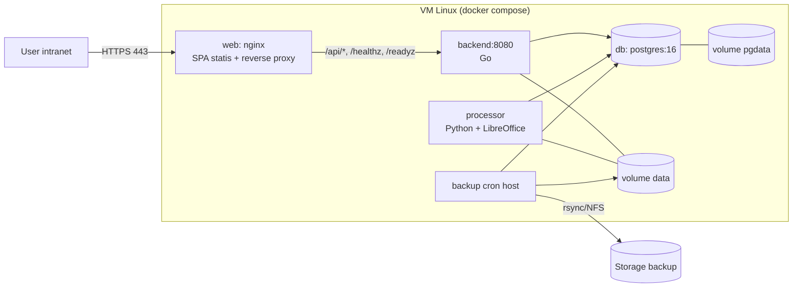
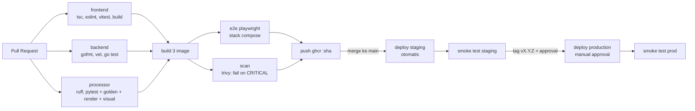

# Dokumen Technology Stack Aplikasi Web "diLPPin"

Dokumen ini menjelaskan technology stack, arsitektur environment, dan alur CI/CD dari sisi DevOps.
*Disusun oleh: Abdul Ghofur, DevOps. Versi 1.0, 21 Oktober 2026.*


## 1. Ringkasan Project
diLPPin merupakan project Web Aplikasi, aplikasi ini memudahkan dalam membuat laporan pelaksanaan pekerjaan.Tujuannya supaya setiap awal bulan, report LPP (Laporan Pelaksanaan Pekerjaan) bulan sebelumnya bisa dibuat otomatis. Format hasilnya harus mengikuti Laporan Pelaksanaan Pekerjaan (LPP) yang sekarang, jadi tim nantinya cukup review dan finalisasi, tidak perlu menyusun report dari awal. 

## 2. Technology Stack

| Bagian | Folder | Stack | Fungsi | Alasan pemilihan |
| --- | --- | --- | --- | --- |
| Frontend | frontend/ | React + TypeScript (Vite SPA), Tailwind + shadcn/ui, React Query | Tampilan aplikasi yang dilihat dan dipakai pengguna. Hasil build berupa file statis yang disajikan Nginx. React Query mengambil data dan memeriksa status job |Hasil build berupa file statis yang disajikan Nginx, sehingga tidak butuh server Node saat berjalan dan hemat resource VM. TypeScript menangkap kesalahan tipe sebelum rilis (dicek `tsc` di pipeline). React Query memudahkan pengambilan data dan pemeriksaan status job; shadcn/ui + Tailwind mempercepat pembuatan tampilan yang konsisten. 
| Auth | auth/ | Node + Better Auth: daftar, login, OTP email, lupa sandi, sesi, admin user; menerbitkan JWT ES256 | Mengurus akun pengguna: daftar, login, OTP email, lupa sandi, sesi, dan admin user. Setelah login, menerbitkan token JWT ES256 |Fitur login, OTP email, lupa sandi, dan sesi sudah tersedia sehingga tidak dibuat dari nol, yang mengurangi risiko celah keamanan buatan sendiri. JWT ES256 bersifat asimetris: backend cukup memegang kunci publik untuk memverifikasi, tanpa bisa menerbitkan token. 
| Backend | backend/ | Go (stdlib net/http, pgx, goose): API, upload, antrian job, verifikasi JWT dan izin dari DB | Inti API: menerima upload, mengelola antrian job, memverifikasi JWT, dan memeriksa izin pengguna dari database |Go menghasilkan satu binary ringan dengan startup cepat dan memori kecil, cocok untuk VM yang juga menjalankan LibreOffice. Pustaka standar `net/http` meminimalkan dependensi. pgx adalah driver PostgreSQL yang efisien, dan goose membuat perubahan skema database terversi dan dapat dilacak. 
| Processor | processor/ | Python: pandas/openpyxl, docxtpl, LibreOffice headless (PDF), AI agent (v0.3) | Mengerjakan proses berat: mengolah data, mengisi template Word, dan mengubahnya ke PDF. Berjalan terpisah dari backend2 | Python punya ekosistem pengolahan data dan dokumen paling lengkap (pandas, openpyxl, docxtpl) dan mudah memanggil LibreOffice untuk PDF. Dipisah dari backend agar proses berat tidak mengganggu API dan resource-nya bisa dibatasi sendiri. Ekosistem AI juga kuat di Python (AI agent v0.3).
| Template LPP | lpp\_templates/ | template.docx + manifest.yaml + processor.py per template | Menentukan bentuk dan logika tiap jenis laporan. Jenis laporan baru ditambah lewat template baru tanpa mengubah kode inti |Format laporan berupa file Word, sehingga bentuk laporan bisa disesuaikan tanpa mengubah kode inti. Logika tiap jenis laporan terpisah (manifest dan processor per template), jadi menambah jenis laporan baru tidak berisiko merusak yang lama. 
| Database | - | PostgreSQL (termasuk PL/pgSQL untuk function dan migrasi) | Menyimpan data aplikasi (pengguna, peran, pekerjaan, laporan) dan berfungsi sebagai antrian job |Data aplikasi (pengguna, peran, pekerjaan, laporan) bersifat relasional dan butuh transaksi yang andal. PostgreSQL juga dipakai sebagai antrian job, sehingga tidak perlu menambah komponen seperti Redis atau RabbitMQ. Open source tanpa biaya lisensi, dan PL/pgSQL tersedia untuk function dan migrasi. 
| Deploy | deploy/, docker-compose.yml | Docker Compose di VM Linux internal, Nginx sebagai reverse proxy | Menjalankan semua komponen di satu VM. Nginx menyajikan frontend, meneruskan request API, dan menjadi satu-satunya pintu masuk dari luar | Aplikasi internal di satu VM, jadi Docker Compose cukup dan jauh lebih sederhana daripada Kubernetes. Docker membuat environment dev, staging, dan production seragam. Nginx menyajikan SPA, meneruskan API, dan menjadi satu-satunya pintu masuk dari luar. 
| Script bantu | - | Shell (Bash) | Tugas sederhana seperti backup terjadwal dan setup |Shell tersedia di semua server Linux tanpa dependensi tambahan, cocok untuk tugas sederhana seperti backup terjadwal dan setup. 

**Sumber data stack:** komposisi bahasa dan topik repository diambil dari halaman GitHub project documen README.md (situs: https://github.com/mahasajo/diLPPin/blob/main/README.md). Komposisi bahasa saat ini:

| Bahasa | Persentase | Peran |
| --- | --- | --- |
| TypeScript | 48,4% | Frontend React |
| Python | 23,9% | Service otomasi dan generate laporan |
| Go | 23,6% | Backend API |
| CSS | 1,3% | Styling |
| Shell | 1% | Script bantu |
| PLpgSQL | 0,8% | Function atau migrasi database |
| Lainnya | 1% | - |


## 3. Arsitektur Aplikasi



## Alur Umum Aplikasi

Aplikasi berjalan di satu VM Linux menggunakan Docker Compose dan hanya dapat diakses dari jaringan internal (intranet). Alurnya terbagi tiga: akses pengguna, pembuatan laporan, dan penyimpanan serta backup.

### A. Alur akses pengguna

1. User membuka aplikasi lewat browser dari jaringan intranet menggunakan HTTPS (port 443).
2. Permintaan diterima oleh container `web` (Nginx). Nginx menyajikan tampilan aplikasi (SPA React hasil build) dan bertindak sebagai reverse proxy.
3. Frontend (React) yang berjalan di browser memanggil API dengan alamat berawalan `/api/*`. Nginx meneruskan permintaan ini ke container `backend`.
4. Backend (Go, port 8080) memeriksa permintaan, menjalankan logika bisnis, lalu membaca dan menulis data ke PostgreSQL.
5. Backend mengirim hasilnya kembali lewat Nginx ke browser, dan tampilan diperbarui.

> Nginx adalah satu-satunya pintu masuk dari luar. Backend, database, dan processor tidak dapat diakses langsung oleh pengguna.

### B. Alur pembuatan laporan otomatis

6. User mengisi data atau mengunggah berkas melalui frontend. Backend menyimpan berkas ke volume `data` dan mencatat pekerjaan baru ke database (tabel `jobs`) dengan status menunggu.
7. Service `processor` (Python + LibreOffice) mengambil pekerjaan yang menunggu dari database. Processor tidak dipanggil lewat HTTP dan tidak memiliki port; komunikasinya dengan backend hanya lewat database dan volume `data`.
8. Processor membaca berkas dari volume `data`, mengolah data, mengisi template laporan, lalu membuat dokumen DOCX atau PDF (LibreOffice dipakai untuk konversi PDF).
9. Hasil laporan ditulis ke volume `data`, dan status pekerjaan di database diperbarui menjadi selesai (atau gagal beserta pesan errornya).
10. Frontend memeriksa status pekerjaan lewat API. Setelah selesai, user mengunduh laporan lewat backend, yang membacanya dari volume `data`.

> Karena pekerjaan disimpan di database, pekerjaan tidak hilang bila processor sedang mati; ia akan diproses setelah processor aktif kembali.

### C. Penyimpanan data dan backup

11. PostgreSQL 16 menyimpan data di volume `pgdata`, sehingga data tetap ada walaupun container dihapus atau dibuat ulang.
12. Berkas unggahan dan hasil laporan disimpan di volume `data`, yang dipakai bersama oleh backend, processor, dan proses backup.
13. Proses `backup cron` di host VM berjalan terjadwal, mencadangkan database dan volume `data`.
14. Hasil backup disalin ke storage backup di luar VM melalui rsync/NFS, sehingga cadangan tetap aman jika VM bermasalah.

### D. Pemantauan kesehatan

15. Endpoint `/healthz` menunjukkan apakah backend hidup, dan `/readyz` menunjukkan apakah backend siap melayani (misalnya sudah terhubung ke database). Keduanya dapat dipakai untuk health check Docker dan alat monitoring.

### Ringkasan jalur data

| Jalur | Dari | Ke | Cara |
|---|---|---|---|
| Akses pengguna | Browser | Nginx | HTTPS 443 |
| Permintaan API | Nginx | Backend | HTTP internal (`/api/*`, `/healthz`, `/readyz`) |
| Data aplikasi | Backend | PostgreSQL | Koneksi database |
| Antrian pekerjaan | Backend dan processor | PostgreSQL (tabel `jobs`) | Baca dan tulis status pekerjaan |
| Berkas | Backend dan processor | Volume `data` | Baca dan tulis berkas |
| Backup | Backup cron | Storage backup | rsync/NFS |

### Daftar container

| Container | Image dasar | Port | Keterangan |
| --- | --- | --- | --- |
| processor | dilppin-processor  | - | container yang memproses data yang didapat dari processor|
| backend | dilppin-backend | 8080 | - |
| auth | dilppin-auth | 3000 | -|
| web | dilppin-web | 8000:80 | Layanan web; port 80 di container dipetakan ke port 8000 di host |
| db | postgres | 5432 | Database PostgreSQL |

## 4. Environment

| Environment | Tujuan | Server / Hosting |
| --- | --- | --- |
| Development | pengembangan, hot reload | laptop developer (§4.1) |  
| Production | pemakaian user | VM, compose project `dilppin`, port 443 |  

### Spesifikasi server

| Item | Minimum | Catatan |
|-----|---------|---------|
| OS | Ubuntu Server 24.04 LTS | |
| CPU / RAM | 4 vCPU / 8 GB | LibreOffice render EMS ±1–1,5 GB RAM puncak |
| Disk | 100 GB SSD | data mentah + hasil ±1–3 GB/bulan; pgdata kecil |
| Software | Docker Engine ≥ 27 + compose plugin, chrony (sinkron waktu), ufw | |
| Akses jaringan | Masuk: 443 (user), 22 (admin, dari subnet admin saja). Keluar: registry image; v0.2: Grafana/DB sumber | |
| Zona waktu host | `Asia/Jakarta` | container juga set `TZ` |

Hardening dasar: login SSH key-only, `PermitRootLogin no`, ufw default deny, unattended-upgrades security, user `deploy` (anggota grup docker) untuk deploy.

### Jaringan dan keamanan

- Port yang dibuka ke publik: port 8080.
- Port yang hanya internal: 5432 (PostgreSQL).
- SSL/TLS: Cloudfare.
- Firewall: Cloudfare.

### Manajemen konfigurasi 

- Konfigurasi dibaca dari environment variable, bukan ditulis di kode.
- File `.env` tidak boleh masuk Git. Sediakan `.env.example` berisi nama variabel tanpa nilai rahasia.
- Secret untuk CI/CD disimpan di \[GitHub Secrets / GitLab CI Variables\].
- Variabel penting: `DB_HOST`, `DB_PORT`, `DB_USER`, `DB_PASSWORD`, `DB_NAME`, \[ISI variabel lain\].
- Pihak yang punya akses ke secret: Backend.

### Secret
| Rahasia | Lokasi v0.1 | Rotasi |
|--------|-------------|--------|
| Password DB (juga di `DATABASE_URL`) | docker secret file + `/etc/dilppin/app.env` (600 root) | tahunan |
| SSH deploy key | GitHub Environment secret, scope per environment | tahunan |
| v0.2: token service account Grafana, kredensial DB sumber | `/etc/dilppin/secrets/<nama>` → di-mount sebagai docker secret ke backend, dirujuk `data_sources.secret_ref` | 90 hari |
| v0.3: API key LLM (jika Q-20 mengizinkan) | docker secret ke processor | 90 hari |

- Tidak ada rahasia di repo, image, log, atau tabel DB (DB hanya menyimpan *nama* secret).
- `.env`, `*.pem`, `processor/fonts/*.ttf` (jika berlisensi), `.data/` masuk `.gitignore`.
> ponytail: file secret root-only + docker secrets cukup untuk 1 VM internal. Pindah ke Vault/secret manager perusahaan jika sudah tersedia atau server > 1.

## 5. Struktur Repository

```
diLPPin/
├── .github/
│   └── workflows/            # Pipeline CI/CD GitHub Actions
├── auth/                     # Service autentikasi (Node + Better Auth)
├── backend/                  # API Go (net/http, pgx, goose)
├── contoh/                   # Contoh dokumen/template (mis. LPP EMS Vgreen)
├── deploy/                   # Script deploy server dan konfigurasi deployment
├── docs/                     # Dokumentasi teknis (mis. AUTH.md)
├── e2e/                      # Pengujian end-to-end (Playwright)
├── frontend/                 # React + TypeScript (Vite SPA)
├── lpp_templates/            # Template laporan (template.docx, manifest.yaml, processor.py)
├── poc/                      # Proof of concept / eksperimen
├── processor/                # Service Python pembuat laporan (LibreOffice)
├── .dockerignore
├── .env.example              # Contoh variabel lingkungan (tanpa nilai rahasia)
├── .gitattributes
├── .gitignore
├── AGENT.md                  # Panduan untuk AI agent dan developer
├── BRD.md                    # Business Requirements Document
├── CHANGELOG.md              # Catatan perubahan per rilis
├── CLAUDE.md                 # Panduan konteks project untuk Claude
├── CONTRIBUTING.md           # Panduan kontribusi
├── Goal.md                   # Tujuan project
├── PRD.md                    # Product Requirements Document
├── README.md                 # Ringkasan project
├── docker-compose.yml        # Compose untuk development/dasar
├── docker-compose.prod.yml   # Compose untuk production
├── docker-compose.coolify.yml# Compose untuk deployment lewat Coolify
└── package.json              # Konfigurasi Node tingkat root
```

## 6. CI/CD

### Detail tiap stage
| Job | Isi | Gagal jika |
|----|-----|-----------|
| `frontend` | `npm ci`, `tsc --noEmit`, `eslint .`, `vitest run`, `vite build` | error tipe/lint/test/build |
| `backend` | `gofmt -l .` harus kosong, `go vet ./...`, `go test ./...` dengan service postgres:16 (termasuk `migrate up` dari kosong), `govulncheck ./...` | ada pelanggaran / test gagal / vuln yang terpanggil |
| `processor` | `ruff format --check`, `ruff check`, lalu `pytest -q` **di dalam image processor** (LibreOffice + font sama dengan produksi) termasuk golden test & visual diff | test gagal |
| `build` | `docker build` 3 image dengan cache, tag `:<sha>` | |
| `e2e` | `docker compose` dari image hasil build + DB kosong → `migrate` → Playwright skenario QA §5.1 | skenario gagal |
| `scan` | `trivy image --severity CRITICAL --exit-code 1 --ignore-unfixed` untuk 3 image; `npm audit --omit=dev --audit-level=high`; `pip-audit` | CVE kritis yang ada perbaikannya |
| `push` | push 3 image `:<sha>` | |
| `deploy-staging` | SSH ke VM (secret `DEPLOY_SSH_KEY` di GitHub Environments `staging`) → `deploy/scripts/deploy.sh staging <sha>` | healthcheck gagal |
| `deploy-prod` | GitHub Environment `production` dengan **required reviewers** → `deploy/scripts/deploy.sh production <sha>` | healthcheck gagal → auto rollback |

> ponytail: semua image selalu di-build & di-tag bersama (cache membuat yang tidak berubah cepat). Job lint/test boleh memakai path filter per folder; build tidak, supaya satu `TAG` selalu lengkap.

Jika runner CI tidak bisa menjangkau VM: deploy manual oleh admin dengan perintah yang sama (`deploy/scripts/deploy.sh`), tetap dicatat di CHANGELOG.

## Alur pipeline

### CI/CD Pipeline

Pipeline berjalan di GitHub Actions dan terdiri dari dua fase: **CI** (setiap pull request) dan **CD** (setelah merge dan saat rilis). Image disimpan di GitHub Container Registry (GHCR).

### Alur ringkas

**Pull Request → (frontend ‖ backend ‖ processor) → build 3 image → (e2e Playwright ‖ scan Trivy) → push GHCR `:sha` → merge ke main → deploy staging otomatis → smoke test staging → tag vX.Y.Z + approval → deploy production → smoke test production**

Tanda ‖ berarti tahap berjalan paralel. Jika satu tahap gagal, tahap sesudahnya tidak dijalankan.

### Fase 1: CI pada Pull Request

| Tahap | Pemeriksaan | Tujuan |
|---|---|---|
| frontend | `tsc`, `eslint`, `vitest`, `build` | Cek tipe TypeScript, kerapian kode, unit test, dan memastikan build berhasil |
| backend | `gofmt`, `go vet`, `go test` | Cek format kode Go, analisis kesalahan umum, dan unit test |
| processor | `ruff`, `pytest` + golden + render + visual | Lint Python, unit test, dan pengujian hasil dokumen (lihat catatan) |
| build 3 image | Build image frontend (web), backend, processor | Memastikan ketiga image dapat dibuat |
| e2e | Playwright di stack Docker Compose | Menguji alur pengguna dari browser terhadap aplikasi utuh |
| scan | Trivy, gagal jika ada kerentanan CRITICAL | Mencegah image dengan celah keamanan berat dirilis |
| push | Unggah image ke GHCR dengan tag `:sha` | Menyimpan image yang sudah lolos semua pemeriksaan |

Tiga tahap pertama berjalan paralel agar lebih cepat. Build image hanya berjalan jika ketiganya lolos.

**Catatan pengujian processor** (berdasarkan pembacaan nama tahap di diagram, perlu dikonfirmasi ke developer):

- **golden:** hasil dokumen dibandingkan dengan berkas acuan yang sudah dianggap benar.
- **render:** memastikan dokumen berhasil dirender (DOCX ke PDF lewat LibreOffice).
- **visual:** membandingkan tampilan hasil render, sehingga perubahan layout atau font ketahuan.

### Fase 2: CD setelah merge

| Tahap | Pemicu | Keterangan |
|---|---|---|
| Deploy staging | Merge ke `main` | Otomatis, tanpa approval |
| Smoke test staging | Setelah deploy staging | Cek cepat bahwa aplikasi hidup (misalnya `/healthz`, `/readyz`, dan alur dasar) |
| Deploy production | Tag `vX.Y.Z` + approval manual | Rilis ke production hanya setelah ada persetujuan |
| Smoke test production | Setelah deploy production | Memastikan rilis berjalan normal; jika gagal, lakukan rollback |

### Pengaman (gate) dalam pipeline

| Pengaman | Mencegah |
|---|---|
| Lint dan test paralel | Kode rusak masuk ke tahap build |
| Trivy fail on CRITICAL | Image dengan celah keamanan berat dirilis |
| E2E Playwright | Bug yang hanya muncul saat semua komponen bersatu |
| Staging otomatis | Masalah deploy ketahuan sebelum menyentuh production |
| Approval manual | Rilis production tanpa sepengetahuan penanggung jawab |
| Smoke test production | Rilis yang diam-diam gagal tidak terdeteksi |

### Strategi tag

- `:sha` (hash commit): untuk setiap image dari pull request atau merge, mudah dilacak.
- `vX.Y.Z`: untuk rilis production, dan menjadi acuan rollback.


## 7. Backup, dan Rollback

### Rollback

| Kasus | Langkah |
|------|---------|
| Aplikasi bermasalah, skema DB kompatibel (expand/contract dipatuhi) | `TAG=<prev_sha> docker compose -p dilppin up -d backend processor web` → `deploy/scripts/smoke.sh production` |
| Migrasi merusak data | stop backend & processor → restore dump `pre-deploy` (§11) → deploy tag sebelumnya |
| Template DOCX salah | template ikut image processor → rollback image. LPP yang sudah Final tidak terpengaruh (file sudah tersimpan) |

Verifikasi setelah rollback: healthz/readyz 200, generate 1 LPP sample, cek log processor tanpa error 10 menit.

## 8. Monitoring dan Logging

| Aspek | v0.1 | v0.2 |
|------|------|------|
| Uptime | Tambah monitor HTTP `/readyz` ke Uptime Kuma / monitoring yang sudah ada | sama |
| Log | `docker compose logs <service>`, JSON (field sama di backend & processor), rotasi 100 MB/service | kirim ke Loki/ELK bila tersedia |
| Metrik | — | endpoint `/metrics` di backend (Prometheus `client_golang`): request, durasi; antrian & durasi job dihitung dari tabel `jobs` → dashboard Grafana |
| Disk | cron cek `df` > 80% → email | alert Prometheus node_exporter |
| Job gagal | ditampilkan di UI + audit | alert jika ada `jobs.status='failed'` atau run terjadwal `partial/failed` |
| Backup | log + email jika gagal | metrik umur backup terakhir |

## 9. Troubleshooting Umum

| Gejala | Cek | Tindakan |
|-------|-----|---------|
| Web tidak bisa dibuka | `docker compose ps`, `curl -k https://localhost/healthz` | `docker compose up -d`; cek `logs web --tail 200`, `logs backend --tail 200` |
| Halaman putih / error JS setelah deploy | console browser, `logs web` | hard refresh; pastikan `index.html` dikirim `no-cache` (§5) dan image `web` ber-tag sama dengan backend |
| Generate macet di "Membuat dokumen…" | `logs processor`, tabel `jobs` status `running` lama | restart processor (job > 15 menit otomatis dikembalikan ke antrian); cek `soffice` zombie: `docker compose exec processor pkill -f soffice` |
| `/readyz` gagal "processor tidak aktif" | `docker compose ps processor`, `logs processor` | `docker compose up -d processor`; cek koneksi DB dari processor |
| PDF font/layout aneh | `docker compose exec processor fc-match Calibri` | pasang font (§3.2), rebuild image processor |
| Disk penuh | `du -sh /var/lib/docker/volumes/*` | `docker compose exec processor python -m dilppin_proc.cli purge --dry-run` lalu tanpa dry-run; perbesar disk |
| User dapat 403 dari nginx | IP user di luar `allow` (§5) | tambah subnet yang benar di `deploy/nginx.conf`, `docker compose restart web` |
| Restore diperlukan | §11 | catat insiden di CHANGELOG (bagian Incident) |

Setiap insiden produksi → catatan singkat di CHANGELOG bagian *Incidents* (tanggal, dampak, akar masalah, tindakan pencegahan).

## 10. Riwayat Perubahan Dokumen

| Versi | Tanggal | Perubahan | Penulis |
| --- | --- | --- | --- |
| 1.0 | 21 Oktober 2026 | Dokumen awal | Abdul Ghofur |
